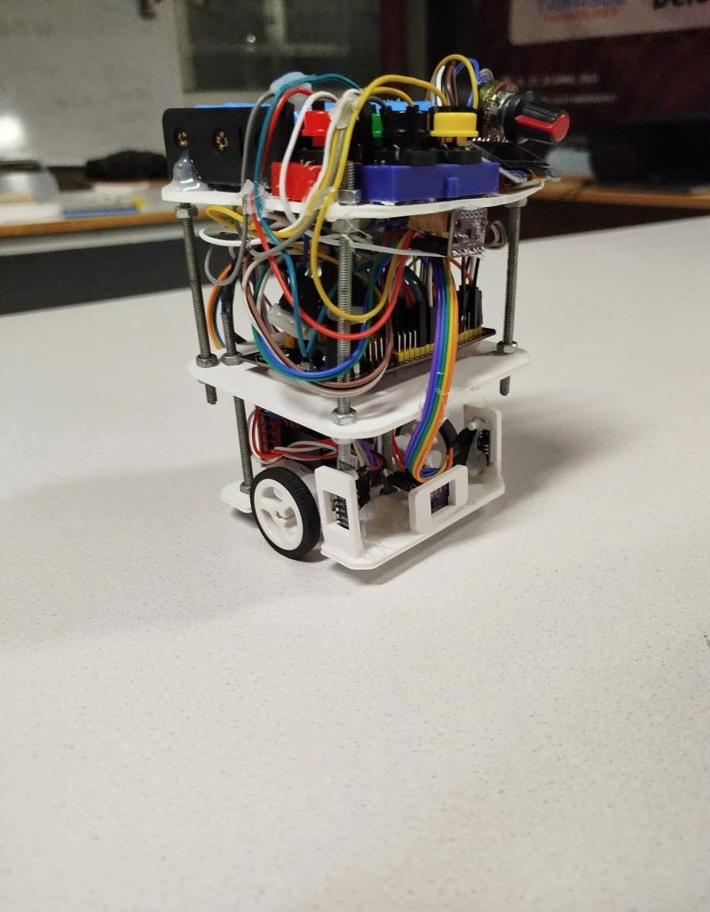
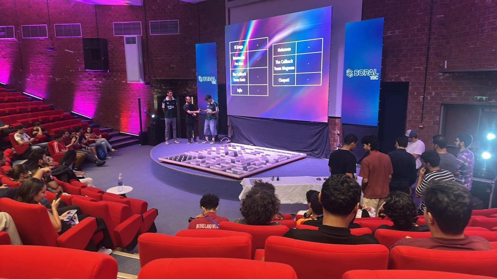
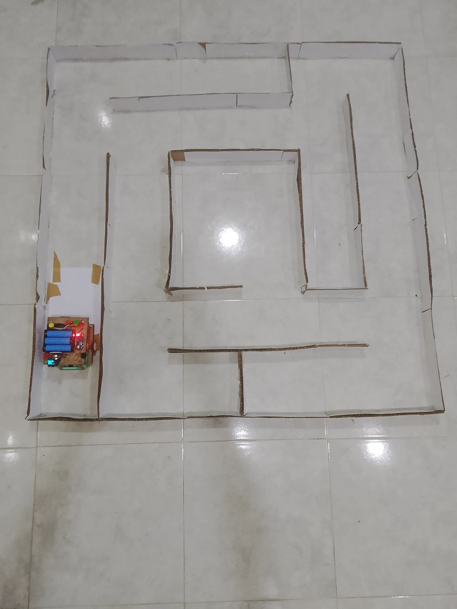

# Micromouse

An autonomous maze solving robot built for the IEEE Micromouse challenge at National Robotics Week 8.0, INSAT Tunisia, September 2026. It placed 3rd.

This repository is an archive of the robot as it competed: the firmware that ran on the day plus two small fixes made afterwards, how it works, and what went wrong on the way there.



## The competition

The rules shaped almost every design decision, so they come first.

- 16x16 maze, 18 cm cell pitch, 1.2 cm walls, 5 cm high
- Start cell in a corner, enclosed on three sides
- Goal is the centre 2x2 block, with a single gateway
- 10 minutes of total maze access, covering exploration and speed runs
- No reflashing once the maze is revealed. Adjusting parameters on the robot itself is allowed
- 30 second penalty every time a human retrieves the robot
- Ties are broken on the longest run of consecutive cells, so a lost robot should keep pushing toward the goal rather than stop

The reflashing rule is why the robot has an OLED settings menu. Anything that depends on the actual maze, such as cell pitch, sensor centring and wall thresholds, has to be adjustable by hand after the reveal. The retrieval penalty and the consecutive cell tiebreak are why reliability mattered more than speed.



## Hardware

| Part | Detail |
| --- | --- |
| Controller | ESP32-WROOM-32, 38 pin, on a Type C expansion shield |
| Motors | 2x N20 12V 1000RPM gearmotors with quadrature encoders, 418 counts per revolution |
| Driver | L298N dual H bridge |
| Wall sensors | 3x VL53L0X time of flight, left, front and right, mounted low enough to see 5 cm walls |
| IMU | LSM6DS3, mounted vertically |
| Interface | SSD1306 0.96 inch OLED, 4 push buttons, 1 potentiometer |
| Power | 3x 18650 Li-ion, 11.1V nominal, through an LM2596 buck regulator |
| Chassis | 8.5 x 8.5 cm base plate, two decks |

The L298N is driven with PWM on the direction pins, with the ENA and ENB jumpers left fitted. It saves two pins and gives the same result.

Because the IMU board stands on its edge, yaw comes from the Y axis (register 0x24), not Z.

The full pin map and the measured constants are in [docs/hardware.md](docs/hardware.md).

## How the firmware works

Everything lives in one Arduino sketch, `firmware/micromouse/micromouse.ino`. It runs a 100 Hz control loop and a menu driven state machine.

### Sign conventions

Most of the bugs during development were sign errors: an encoder counting backwards, a gyro reading upside down, a steering correction pushing the wrong way. The firmware therefore fixes four conventions and sticks to them everywhere.

| Quantity | Positive means |
| --- | --- |
| `heading` | the robot has turned left |
| `latEst` | the robot is nearer the left wall |
| `steer` | turn right |
| `aim` | point further right |

Three settings, gyro sign, steer sign and turn sign, can be flipped from the menu so that any wiring meets these conventions without editing the source. The "Test: signs" screen shows the live heading and lateral estimate with the expected direction next to each, so you can rotate the robot by hand or push it toward a wall and see straight away whether a sign is wrong.

### Cascade wall following

The first version added a heading correction and a wall distance correction together and sent the sum to the motors. The two terms fought each other. On a differential drive the lateral position is the integral of the heading, so a proportional term acting directly on lateral error can only lag or oscillate, and raising its gain makes that worse.

The current design is a cascade. The outer loop looks at how far the robot is from the corridor centre line and turns that into a target heading: "aim a few degrees right". The inner loop is a fast gyro loop that drives the actual heading to that target. The outer loop never touches the motors directly.

I simulated both designs over 48 start conditions per case:

| Case | Old design | Cascade |
| --- | --- | --- |
| Two walls, 250 mm/s | 6.4 mm worst excursion, 5 crashes | 0.5 mm, no crashes |
| One wall, 400 mm/s | 25 mm worst excursion, 36 crashes | 0.7 mm, no crashes |

The simulation also showed that the inner gain must be at least 6 or the loop goes unstable. The old gain was 0.6, which explains why nudging it upward never helped.

### Lateral offset estimator

There is one shared estimate of how far the robot is from the centre line. The two side sensors are calibrated differently and sit at different distances from their walls when the robot is centred, so each sensor is compared against its own measured centred reading. With both walls present the two estimates are averaged, and they agree when the robot really is centred.

If the two side readings do not add up to the corridor width within 30 mm, one sensor is lying. Neither is trusted and the mode shows `BAD!` on the diagnostics screen.

Between sensor readings the estimate is carried forward by odometry, using speed times the sine of the heading error. This matters at speed. The sensors take turns, so a given side refreshes roughly every 60 ms, and differencing two readings that far apart is too slow and too noisy to steer on.

### The integral term is a gyro bias estimate

The outer loop has an integral term, but it is not there to remove generic steady state error. What it actually learns is how wrong the gyro's idea of "square to the maze" is. That error belongs to the robot, not to any particular cell, so the term is held through gaps in the walls and carried from one cell to the next instead of being reset. It only learns from fresh sensor readings, so it cannot wind up while crossing an opening. It appears on the diagnostics screen as `bias`. Running "Calibrate gyro" clears it, because a calibration redefines square.

### Wall sensing

The VL53L0X sensors range one at a time, round robin, using single shot measurements. With all three running at once, the side lasers picked up each other's reflections off the corridor walls.

Readings go through an asymmetric filter. A wall disappearing is real information, so readings that jump further away are accepted quickly. A reading that suddenly gets much closer is usually a lattice post, so that change is rate limited. Wall flags use 15 mm of hysteresis. A sensor that stops updating, keeps returning the identical value, or returns physically impossible distances is marked unhealthy and ignored.

A sensor that cannot be trusted leaves its wall boundary unknown. It never records the boundary as open, because a false "open" sends the planner into a wall later.

### Flood fill

The planner is a breadth first flood from the goal cells. It runs in two modes:

- **Optimistic**, while exploring. An unexamined boundary counts as open, so the robot heads for unexplored shortcuts.
- **Known only**, for the speed run. An unexamined boundary counts as a wall, so the planned path is guaranteed to exist.

When choosing between equally good neighbours, straight ahead wins so the robot does not turn when it does not need to.

After reaching the goal the robot returns to the start optimistically, which maps new ground on the way back. It then compares the known only path length with the optimistic one and reports `OPTIMAL` or `approx`.

### Cell moves are all or nothing

Every move ends in one of two states. Either the robot is at the centre of the next cell and its position advances, or it is back in the cell it started from and its position does not change. It is never left half way. Movement the robot is not tracking is what destroys its position estimate.

When a front wall is visible, the remaining distance comes from the front sensor reading rather than from integrated encoder counts. When the robot stops in front of a wall it uses that wall to square up its heading.

### Stuck recovery

If the planner finds no route from the current cell, the map almost certainly contains a false wall reading, and that bad reading is almost certainly nearby. The robot first re-reads its surroundings. If it is still boxed in, it forgets the walls in a growing radius around itself, from 1 up to 4 cells, and replans. Wiping the whole map would throw away mapping that cost real time. Spinning in place would never fix anything.

Each cell also keeps a failure count per direction. If a move from a cell in a given direction fails twice for a reason the sensors cannot explain, a wall is recorded there anyway, so the planner cannot keep choosing the same blocked move.

### Settings in NVS

Nineteen parameters can be edited from the OLED using the potentiometer and are stored in the ESP32's NVS through `Preferences`, so they survive a battery swap. This is the answer to the no reflashing rule. Everything that depends on the actual maze can be measured and set on site.

## Debugging history

These are the problems that actually cost time, roughly in the order they appeared.

**ESP32 boot loop.** The board looped on `assert failed: __esp_system_init_fn_init_flash`. The flash was corrupted. `esptool erase-flash` fixed it, followed by uploading with flash mode DIO at 40 MHz and 115200 baud.

**VL53L0X initialisation failures.** This took a lot of wrong theories. It turned out to be two separate problems. First, the sensor modules were getting 3.3V on VIN when they needed 5V. Second, once each sensor worked on its own, they still failed together because of crosstalk. The fix was round robin single shot ranging, so only one laser fires at a time.

**Gyro reading 8x too small.** A 90 degree turn registered as about 11 degrees. The IMU board is mounted vertically, so its Z axis points sideways. A sweep across all three axes while rotating the robot showed that Y, register 0x24, is yaw.

**Gyro bias subtracted twice.** The calibration routine sampled through a function that had already subtracted the bias, so each calibration moved the bias further from the truth. The read was split into a raw read and a compensated read, and calibration uses the raw one.

**The robot drove and turned forever.** The distance travelled came out negative, so no move ever reached its target. Both encoder ISRs had their signs inverted relative to the motor direction test that had already been confirmed working.

**The robot spun instead of driving straight.** The right encoder counted backwards, which fed the velocity PID a wheel speed with the wrong sign. The PID then pushed that wheel harder and harder.

**Wobbling wall following.** This was found by reading the code, not by tuning gains. There were two causes. First, there were two wall follower implementations in the same file, and the wall mode variable was only updated by the diagnostics screen, so the drive routine was steering on stale data. Second, one shared side target distance was used for two sensors with different calibrations, so the lateral estimate flipped between two opposite values each time a different sensor reported. The result is the single estimator described above.

**Lateral estimate frozen at -10.** The diagnostics screen never called the update function, so it kept showing whatever value was left over from the last move. Every live screen now recomputes what it shows on every refresh.

**Turn brake pulse in the wrong direction.** At the end of a turn a short reverse pulse kills the robot's momentum. It was hardcoded for a left turn, so on right turns it accelerated the robot into the turn instead. The pulse now takes its sign from the direction of the turn.

**Missed walls.** Simulating the sensor filter showed that a newly appearing wall needs three filtered samples to cross the detection threshold, but the sensor refresh before reading walls only waited for two. Wall reads now wait for three fresh readings from each sensor.

**Reversing after a blocked move.** When a front wall stopped a move, the robot backed up the whole distance it had travelled to return to the start of the cell. But a front wall stop always leaves the robot exactly `FRONT_CENTRE_MM` from that wall, which is the cell centre already. The reversing was pointless shuffling and is gone. The robot now only backs up after a stop with some other cause, and only if it moved more than 30 mm.

### A deliberate non-change

A verification pass after the return trip, which goes back to check boundaries the speed run would rely on, raised the share of optimal speed run paths in simulation from 71 to 100 percent. It costs about 48 extra cells of exploration to save under half a second on the run. That is 48 more chances to hit a wall and pay a 30 second retrieval. While reliability was the limiting factor it was the wrong trade, so it was left out.

## Known limitation

The speed run uses the same cell by cell loop as exploration. It stops, brakes and settles in every cell instead of driving along the planned path, so a higher speed setting buys much less time than it should. See [docs/speed-run-path-follower.md](docs/speed-run-path-follower.md) for the design of the fix, which was started but never finished.

## Building and flashing

Arduino IDE or `arduino-cli` with the ESP32 core. Board: ESP32 Dev Module.

Libraries:

- Adafruit_VL53L0X
- Adafruit_GFX
- Adafruit_SSD1306

`Wire` and `Preferences` come with the ESP32 core.

```
arduino-cli compile --fqbn esp32:esp32:esp32 firmware/micromouse
arduino-cli upload  --fqbn esp32:esp32:esp32 -p /dev/ttyUSB0 firmware/micromouse
```

If the board boot loops after flashing, erase it with `esptool erase-flash` and upload again with flash mode DIO, 40 MHz flash and 115200 upload speed.

The serial monitor runs at 115200 and prints sensor and gyro status at boot plus a summary after each run.

## Using the robot

At power on the robot calibrates the gyro, so keep it still until it shows `READY`.

Buttons:

| Button | Pin | Action |
| --- | --- | --- |
| Up | 16 | previous item |
| Down | 13 | next item |
| Select | 2 | run the item, or next parameter in Settings |
| Stop | 5 | abort a move, or save and leave Settings |

The potentiometer sets the speed for the test moves (shown as `SPD` in the menu header) and edits values in Settings.

| Menu item | What it does |
| --- | --- |
| EXPLORE | flood fill to the goal, then optimistic return to start |
| SPEED RUN | known only path to the goal at run speed. Needs a completed explore |
| Return to start | navigate back to the start cell |
| Calibrate gyro | re-measure gyro bias and clear the learned heading bias |
| Diagnostics | live sensor readings, wall flags, lateral estimate, bias, heading, encoder counts |
| Test: signs | live sign check for the three sign settings |
| Show map | the mapped walls in a 7x7 window around the robot |
| Settings | edit and save parameters |
| Test: cell probe | front, left and right readings for measuring the centring constants |
| Test: corridor | 1000 mm straight with wall following |
| Test: one cell | a single cell move |
| Test: read walls | read and record the walls in the current cell |
| Test: turn 90 | one right turn |
| Test: drive 500 | 500 mm straight without walls, for checking the wheel diameter |

The on site calibration procedure is in [docs/calibration.md](docs/calibration.md).



The practice maze, built from cardboard, with an earlier perfboard version of the robot.

## Result

3rd place, IEEE Micromouse, National Robotics Week 8.0, INSAT, September 2026.

Built at INSAT by:

- Ahmed Ben Salah, lead on most of the hardware and software
- Mohamed Amine Ayari
- Mohamed Aziz Chaibi
- Mohamed Ayoub Ayari
- Ons Najjar

## License

MIT, see [LICENSE](LICENSE).
